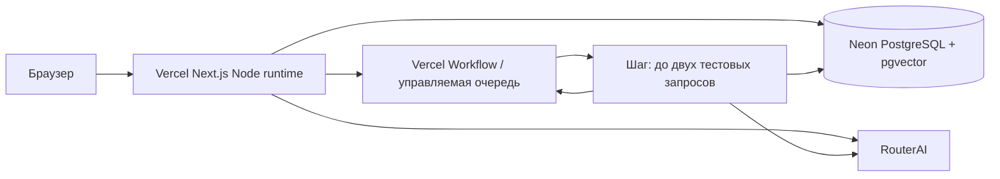

# Аудит и подготовка Vercel + Neon

Дата: 3 ноября 2026. Исходная `main`: `1727f0851c56a66758e5b4963dc5c8952584d235`.
Все изменения подготовлены в `feat/vercel-migration`. Эта работа не разворачивает
Vercel/Neon, не меняет Railway и не переносит действующую БД.

## Совместимость

## Прозрачная гибридная диагностика RAG

Поиск независимо ранжирует весь активный корпус по косинусной близости pgvector
и по BM25 Okapi (k1=1.2, b=0.75) над токенами русского Snowball stemmer.
Лексический ранг не использует PostgreSQL `ts_rank`; точное совпадение кода
вида `AD-413:` получает приоритет, а случайные BM25 совпадения ниже 0.45
отбрасываются. Списки двух методов остаются раздельными, пересечение явно
помечается; контекст модели собирается из fused topK и возвращается в ответе
с тем же набором articleId/title/content, сериализованным в prompt.

Чат показывает свёрнутую диагностику с вкладками векторного поиска, BM25 и
точного контекста LLM. Оценки и позиции относятся к конкретному поисковому
списку; причины исключения кандидатов из fused topK сохраняются вместе с
контекстом, который не реконструируется после вызова. JSON диагностики хранится
в `Message.diagnostics`; API истории возвращает его владельцу чата, и UI
восстанавливает ответ без повторного поиска или вызова модели. В plain-режимах
обе выдачи и контекст пусты, UI сообщает, что поиск отключён. Цитаты генерируются только
для ID источников из fused списка, недопустимые ID заменяются предупреждением.
Нажатие на цитату встроенной статьи открывает её в базе знаний; цитата загруженного
документа открывает соответствующий фрагмент в диагностической панели. Ответ
без проверенной ссылки помечается для проверки. При пустой выдаче модель не
вызывается, а возвращается фиксированный отказ без догадок.

Автоматические unit-проверки покрывают AD-413, русский перефразированный запрос,
реальный BM25 score, слияние и пересечение рангов, точный payload контекста,
валидацию цитат, отказ при пустой выдаче и четыре комбинации baseline/strong ×
RAG/plain. `npm test` запускает также интеграционный suite. Изолированная проверка
UI без БД и RouterAI: `npm run test:e2e:ui`; полный браузерный suite с отдельной
тестовой БД: `npm run test:e2e`.

| Компонент                         | Вывод и необходимое изменение                                                                                                                                                                                                                                                                                                                                                                                                                                 |
| --------------------------------- | ------------------------------------------------------------------------------------------------------------------------------------------------------------------------------------------------------------------------------------------------------------------------------------------------------------------------------------------------------------------------------------------------------------------------------------------------------------- |
| Next.js 16.4.3, React 19, Node 24 | Поддерживается Node.js runtime; Edge не подходит для pg, PDF/DOCX и LSA. Сборка остаётся `npm run build`. `start:railway` на Vercel не запускается.                                                                                                                                                                                                                                                                                                           |
| Prisma 7.10.1                     | JS PostgreSQL adapter уже используется, native query engine не нужен. Один PrismaClient на процесс, пул максимум 3 соединения, connection timeout 15 секунд, idle timeout 10 секунд. Singleton не является глобальным для всех Vercel instances.                                                                                                                                                                                                              |
| Neon PostgreSQL                   | `DATABASE_URL`: TLS pooled endpoint `-pooler`; `DIRECT_URL`: прямой TLS endpoint той же БД для миграций. Session advisory lock мигратора и старого worker нельзя использовать через transaction pooler. Не отключать проверку TLS.                                                                                                                                                                                                                            |
| pgvector и RAG                    | Neon поддерживает `CREATE EXTENSION vector`, `vector(256)`, cosine `<=>`, русский FTS и транзакционные advisory locks. SQL и исходная миграция сохранены. Локальная LSA работает на CPU, без внешнего embedding API. Для 35 статей подходит; большие загруженные корпуса требуют замера CPU, памяти и времени переиндексации.                                                                                                                                 |
| Ресурсы сборки                    | Markdown и JSON принудительно включены в file tracing API и Workflow. Во время build нет миграций, seed или обязательного обращения к RouterAI/БД. PDF/DOCX parsers остаются server external packages. PDF.js worker, fonts/cmaps/wasm и native canvas включены явно: автоматический tracing не обнаруживает все динамические зависимости PDF.js.                                                                                                             |
| RouterAI                          | Серверный OpenAI-compatible SDK сохраняется, ключ не отправляется в браузер. SDK retries = 0. В Vercel timeout одного upstream-вызова ограничен 90 секундами: проверка каталога + completion должны поместиться в шаг вместе с RAG и записью результата. Каталог продолжает проверяться перед генерацией; startup-проверка на каждом Vercel cold start отключена. `/health` на Vercel может показывать `not-checked`: это не проверка доступности провайдера. |
| Авторизация и состояние           | Подписанные cookies, CSRF/origin, PostgreSQL rate limits, настройки, история чата, документы и результаты сохраняются. `APP_ORIGIN` задаётся отдельно для production и preview. Не переносить корпоративный production origin в preview.                                                                                                                                                                                                                      |
| Документы до 20 МиБ               | Тело запроса функции ограничено 4.5 MB. UI передаёт части по 3 МиБ в PostgreSQL, затем сервер собирает файл и использует прежние PDF/DOCX/MD/TXT проверки. Идентификатор загрузки привязан к session owner. Один временный файл на owner, TTL 30 минут; просроченные части удаляются при следующем начале загрузки. Постоянных оригиналов файлов на диске нет. Список документов возвращает metadata без полного текста.                                      |
| Пакетные тесты                    | До 240 запросов нельзя помещать в одну Vercel Function. Перенесены на Workflow SDK 5.3.0: максимум две пары вопрос/режим в шаге, контрольная точка в PostgreSQL, затем durable sleep и следующий шаг. Все четыре режима, split 48/12, ручная оценка, отмена и CSV сохранены.                                                                                                                                                                                  |

Платформенные ограничения и источники проверены 3 ноября 2026:

- [Vercel Functions limits](https://vercel.com/docs/functions/limitations): Hobby/Fluid до 300 секунд, request/response body 4.5 MB. API задаёт 300 секунд; SDK задаёт максимальную допустимую платформой длительность Workflow handler.
- [Vercel Cron](https://vercel.com/docs/cron-jobs/usage-and-pricing): Hobby один запуск в сутки; поэтому cron не выбран для интерактивной очереди.
- [Workflow + Next.js](https://workflow-sdk.dev/docs/getting-started/next): `withWorkflow`, серверный `start`, durable steps.
- [Workflow pricing](https://vercel.com/docs/workflows/pricing): Hobby имеет включённые квоты; compute и Queues учитываются отдельно. Бесплатность всех будущих прогонов не гарантируется. Перед активацией проверить текущие квоты, назначение Hobby, ограничения расходов и тариф аккаунта. Платный план не подключать без согласования.
- [Neon pgvector](https://neon.com/docs/extensions/pgvector), [Neon pooling](https://neon.com/docs/connect/connection-pooling).

Доступность RouterAI из конкретного региона Vercel, Neon TLS/pooler и ограничения
аккаунта требуют проверки в preview. Локальные тесты не доказывают эту доступность.
Регион Vercel нужно выбрать рядом с Neon и проверить задержки RouterAI.

## Официальные Neon Skills

В этой ветке командой `npx neon skills -y` установлен официальный набор из
[`neondatabase/agent-skills`](https://github.com/neondatabase/agent-skills).
Инструкции находятся в `.agents/skills/`, версии содержимого закреплены в
`skills-lock.json`. Для настройки PostgreSQL используются `neon` и
`neon-postgres`, с сохранением существующих Prisma/pg, RouterAI и архитектуры
Vercel Workflow. Установка проверена с Neon CLI 8.17.1.

Перед дальнейшей настройкой проверить доступный профиль командой
`npx neon profile list -o json` без вывода ключей. На момент установки в новой
среде профиль не авторизован, `NEON_API_KEY` и подключение к проекту отсутствуют.
Это не свидетельствует об отсутствии аккаунта у владельца: существующий проект
нужно выбрать после авторизации. Установка навыков не создаёт облачную БД.

Согласно навыку, для Vercel используется pooled connection, а миграции и dump
выполняются через direct connection. CLI называет прямой URL
`DATABASE_URL_UNPOOLED`; в текущем приложении это значение нужно передать как
`DIRECT_URL`. При будущем `neon link` / `neon checkout` использовать
`--no-env-pull`, чтобы не перезаписать конфигурацию приложения; необходимые
переменные загружать отдельно в защищённый, игнорируемый Git файл. Проверка
миграции выполняется на отдельной Neon-ветке до production.

## Архитектура и выполнение тестов



`EVALUATION_EXECUTOR=workflow` включает Workflow. На Vercel это default и
единственный допустимый исполнитель; локально и на Railway default — `worker`.
Standalone worker выбирает только записи `executor=worker`; Workflow — только
`executor=workflow`. Старые Railway startup/config сохранены.

API сохраняет snapshot в БД и вызывает `await start(evaluationWorkflow, [id])`.
Запуск не зависит от открытого браузера. В Workflow передаются только ID и номера
пакетов, ответы и эталоны хранятся в PostgreSQL. Сгенерированные внутренние
handlers защищаются платформой Vercel Queues; не переносить local World в
публичное production окружение.

DB row lock + номер пакета + lease предотвращают повторный запуск одного пакета.
Результат и счётчик прогресса сохраняются одной транзакцией. Успешно сохранённый
пакет при повторной доставке пропускается. Workflow step `maxRetries=0` и SDK
RouterAI `maxRetries=0`: неоднозначный платный запрос не повторяется автоматически.
Если worker потерян после отправки запроса до записи результата, нельзя доказать,
списал ли провайдер деньги. Явный повтор такого теста может повторно тарифицироваться.

Lease выполнения — 6 минут, ожидания/доставки — 10 минут. API при чтении тестов
или работе с документами переводит просроченные Workflow jobs в `interrupted`.
Поздние результаты старого lease не записываются. Пользователь может отменить
прогон и явно повторить ошибки/неоконченные пары. Отмена проверяется перед каждым
пакетом; уже отправленные запросы завершатся. Закрытие вкладки не отменяет тест.

## Подготовка preview (после согласования ресурсов)

### Подключение Vercel и Neon через Marketplace

Проверка аккаунта Vercel от 7 ноября 2026 подтвердила авторизацию и доступ к
команде `aksklichkov-7717s-projects`. В этой команде пока нет проекта AgentDesk,
а список установленных Marketplace-интеграций пуст. Neon не подключён к этой
сессии отдельным API-коннектором. Это означает, что существование и содержимое
Neon-проекта `agentdesk-vercel` на данный момент не проверены.

1. Войдите в нужный аккаунт на [Vercel Marketplace](https://vercel.com/marketplace),
   найдите **Neon Serverless Postgres** и нажмите **Add Integration / Install**.
   Выберите команду `aksklichkov-7717s-projects`. Если Neon попросит войти или
   подтвердить доступ к Neon, завершите авторизацию в аккаунте, где находится
   `agentdesk-vercel`.
2. В мастере Neon выбирайте только существующий проект `agentdesk-vercel` и его
   базу `agentdesk_rag`, если они явно доступны. Не соглашайтесь на создание
   нового проекта/базы. Если существующий проект не отображается, остановитесь:
   сначала проверьте, что Vercel-интеграция авторизована под правильным Neon
   аккаунтом. Не вставляйте сюда секреты и не используйте Railway URL.
3. На текущий момент проекта AgentDesk в Vercel нет. В Vercel откройте **Add New
   → Project**, импортируйте GitHub-репозиторий
   `AksentyK/agentdesk-support-rag` и выберите production branch `main`, если
   мастер требует её указать. Создание проекта не означает production cutover;
   не добавляйте домен и не переводите на него трафик. В **Settings → Git**
   проверьте, что Preview deployments включены для `feat/vercel-migration`.
   Если проект создаётся автоматически вместе с Neon, не создавайте второй.
4. В **Project → Settings → Environment Variables** проверьте Preview variables.
   Neon integration должна добавить переменные подключения для Preview. Используйте
   pooled TLS URL для `DATABASE_URL`; прямой URL (`DIRECT_URL`) нужен миграционному
   оператору, но не обязан быть runtime-переменной приложения. Значения храните
   только в Vercel и защищённой среде, никогда не коммитьте их и не присылайте в чат.
   Убедитесь, что переменные указывают на подтверждённую целевую Neon БД, а не на
   Railway или production-ветку.
5. До запуска `db:migrate` выясните, пуста ли выбранная база. Если это чистая
   отдельная Preview-БД, примените `npm run db:migrate` и `npm run db:seed` из
   доверенной среды: seed загрузит 35 статей и 60 вопросов. Если в Neon уже есть
   данные, не запускайте seed и не восстанавливайте dump поверх них; сначала
   сделайте проверенный backup и определите, нужен ли snapshot-copy сценарий ниже.
6. Выполните Preview deploy только после проверки ветки, переменных и назначения
   БД. Проверяйте URL Preview, API и данные. Не нажимайте **Promote to Production**.

Установка Neon через Marketplace сама по себе не переносит данные и не доказывает,
что интеграция использует нужный существующий проект. До завершения шагов выше
миграцию базы считать не выполненной.

Дополнительные параметры Preview после проверки назначения Neon БД:

- Установить Node 24, build command `npm run build`, без custom start command;
  проверить Fluid Compute и доступ к системной переменной `VERCEL_DEPLOYMENT_ID`.
- Добавить серверные Preview variables: `DEMO_ACCESS_PASSWORD`, Preview `APP_ORIGIN`,
  `EVALUATION_EXECUTOR=workflow`, параметры RAG и согласованные RouterAI model IDs/key,
  цены/валюту/дату. Не задавать `WORKFLOW_TARGET_WORLD` в Vercel; не использовать
  `NEXT_PUBLIC_` для ключей.
- `DIRECT_URL` нужен миграционному оператору, но не обязателен для runtime Vercel.
  Не запускать миграции и seed во время build: каждый Preview должен работать с
  явно назначенной тестовой БД.
- Проверить пароль, CSRF, `/api/health`, 35 статей, поиск AD-413 и лимит Team,
  upload PDF/DOCX/MD/TXT (включая файл больше 4.5 MB), удаление/переиндексацию,
  retrieval-run и CSV, отмену и повтор. Закрыть вкладку во время теста и проверить
  завершение после открытия. Отдельно проверить прерывание и истечение lease.
- Проверить RouterAI `/models` из Preview. Реальные генерации и сравнение
  240 запросов выполнять только с согласованным лимитом расходов; автоматические
  проверки используют mock и не расходуют баланс RouterAI.

Локальная проверка Workflow без внешних сервисов:

```sh
npm run build
# DATABASE_URL должен указывать на отдельную тестовую БД с миграциями и seed.
EVALUATION_EXECUTOR=workflow WORKFLOW_TARGET_WORLD=local npm start
# Или весь browser suite без отдельного worker:
E2E_EXECUTOR=workflow npm run test:e2e
```

Local World хранит служебное состояние в `.workflow-data/` и подходит для тестов,
но не заменяет устойчивое хранилище Vercel в production.

## Перенос действующих данных — отдельный этап после разрешения

Сейчас этот этап НЕ выполнен. Railway, его БД, настройки, домен и deployment
остаются действующими. Для согласованного окна переноса потребуется остановить
новые записи/AI-прогоны на источнике, дождаться текущих запросов и получить
консистентный полный dump. Пока источник продолжает принимать записи, ранний
snapshot нельзя считать финальным переносом без потерь.

1. Сохранить полный `pg_dump --format=custom --no-owner --no-acl` из Railway
   в защищённом месте (не Git). Доступ только на чтение; экспорт не удаляет данные.
   Сохранить версии PostgreSQL/pgvector и дату снимка. Проверить backup восстановлением
   в отдельную БД. Не открывать TCP proxy и не менять Railway без отдельного разрешения.
2. Восстановить dump через `pg_restore --exit-on-error --no-owner --no-acl`
   **только в пустую целевую Neon БД**, без `--clean`. Не выполнять `db:seed`
   перед восстановлением. Переносятся документы, версии, chunks и векторы,
   настройки/цены, вопросы, чаты, результаты/ручные оценки и журнал
   `_agentdesk_migrations`. Seed сам по себе не переносит эти данные.
3. Применить добавочную миграцию `npm run db:migrate` с `DIRECT_URL` целевой Neon.
   Не использовать `prisma migrate deploy`: здесь собственный журнал миграций.
4. Сравнить исходный snapshot и цель до новых записей/HTTP-проверок:

   ```sh
   # Переменные задаются защищённо; скрипт не печатает URLs или содержимое строк.
   # SOURCE_DATABASE_URL — источник snapshot; TARGET_DIRECT_URL — копия в Neon.
   npm run db:verify-migration
   ```

   Скрипт выполняет READ ONLY транзакции и сравнивает количество и SHA-256 строк
   всех 11 исходных таблиц, включая vector и ручные оценки. Новые поля исполнителя
   исключены из сравнения, служебные таблицы загрузки/миграций не сравниваются.
   Любое расхождение завершает команду с ошибкой. При непрерывной записи источника
   сравнение с живой БД не заменяет сравнение с финальным snapshot.

5. После успешного сравнения пометить **только в целевой копии** старые незавершённые
   worker jobs как `interrupted`, не удаляя результаты:

   ```sql
   UPDATE "EvaluationRun" SET status = 'interrupted'
   WHERE executor = 'worker' AND status IN ('queued', 'running');
   ```

   Они не запускаются автоматически. В UI можно явно повторить оставшиеся пары.

6. Провести preview smoke tests на целевой БД. Production domain/маршрутизация,
   окончательное переключение и merge выполняются только после отдельного разрешения.

## Откат

До переключения Railway продолжает обслуживать пользователей. Если preview не
проходит проверки, исправить feature-ветку; исходную БД не менять. При проблемах
после согласованного переключения возвращать трафик на Railway только по
утверждённому плану. Если Neon уже принимал записи, сначала сохранить их и
согласовать обратный перенос/сверку: простое возвращение к старому snapshot
потеряет новые данные. Ни БД Railway, ни backup не удаляются этим PR.

## Ограничения готовности

Код и локальные проверки готовят миграцию, но не подтверждают production cutover.
Остаются: согласование ресурсов/лимитов, реальный preview Vercel+Neon, проверка
RouterAI из региона, полный экспорт/сверка данных и разрешение переключения.
Временные upload parts занимают место Neon до lazy cleanup; для большего объёма
нужно отдельно обсудить object storage и фоновый импорт. LSA переиндексирует весь
корпус в транзакции до 120 секунд, поэтому произвольный большой корпус не имеет
гарантии по Vercel CPU/memory/time limits.
